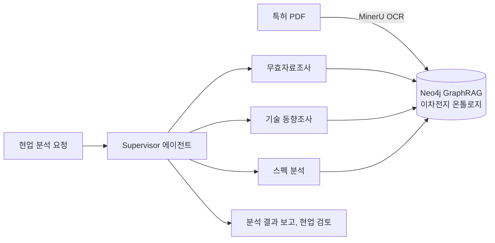

# POSCO Future M Portfolio | 김진원 (KIM JIN WON)

**(주)포스코퓨처엠 (POSCO Future M), IP전략센터 대리 (AI 엔지니어)**
2023.08 ~ 재직 중

이차전지 소재 기업 포스코퓨처엠의 IP전략센터에서 유일한 AI 엔지니어로 일하고 있습니다. 특허 업무의 AI 전환을 전략 수립부터 아키텍처 설계, 개발, 현업 적용까지 전담합니다. 재직 중 프로젝트와 성과를 정리한 저장소입니다.

> 사내 문서, 코드, 데이터는 넣지 않았습니다. 수치와 설명은 리멤버, LinkedIn, GitHub 프로필에 이미 공개한 범위로 맞췄습니다.

## At a Glance

| 구분 | 성과 |
|---|---|
| 특허 분석 에이전트 | Deep Agents 기반 무효자료조사·기술 동향조사·스펙 분석 에이전트 구축, 현업 요청 분석 결과 10건 이상 제공 |
| 자동 분석 | 특허 80건 이상 자동 분석 파이프라인 |
| 정확도 | 음극재 특허 기술분류 정확도 76% → 89% (+13%p), 추가 파인튜닝 없이 프롬프트 설계로 달성 |
| 인텔리전스 | 이차전지 산업 뉴스 하루 200~300건 자동 수집·분류·요약, 경영진과 유관부서에 1년 이상 정기 배포 |
| 플랫폼 | FastAPI 28개 API, Next.js 16 기반 9개 페이지, Streamlit 7탭 대시보드, Slack 봇 5채널 |
| 자문 | 전사 특허시스템 AI 고도화 추진 자문 |

## Projects

### 1. 특허 분석 멀티에이전트 시스템 (Deep Agents)

특허 무효자료조사, 기술 동향조사, 스펙 분석은 많은 특허 문헌을 찾고 읽고 비교해야 하는 전문 업무입니다. 이를 과업 단위로 나눠 에이전트가 수행하도록 설계했습니다. 아키텍처 설계, 에이전트·도구 개발, 현업 적용까지 단독으로 맡았습니다.

- LangChain Deep Agents 기반 Supervisor-Subagent 멀티에이전트 아키텍처 설계·개발
- 특허 본문 파싱, 청구항 분석, 기술 분류, 경쟁사 비교 단계를 서브에이전트로 모듈화하고 FastAPI로 API화해 내부 시스템과 연동
- MinerU OCR로 특허 PDF를 구조화하고, Neo4j GraphRAG로 근거를 검색·연결
- 과업 특성에 맞춰 최신 LLM(GPT-6 Astra, Claude Opus 5.5 등)을 조합하고, Cursor·Claude Code·Codex 같은 AI 코딩 에이전트로 설계부터 구현까지 빠르게 반복
- 결과: 현업 실무 요청 기반 분석 결과 10건 이상 제공, 특허 80건 이상 자동 분석 파이프라인 구축, 전사 특허시스템 AI 고도화 추진 자문
- 확장 중: GraphRAG 기반 경쟁사 특허 스펙 분석·추정 에이전트, 이종 혼합기술 아이디어 자동 도출 에이전트

### 2. 이차전지 도메인 온톨로지 (진행 중)

흩어진 이차전지 기술·특허 지식을 개념과 관계로 구조화해, AI 에이전트가 판단 근거로 쓸 수 있는 지식 기반을 만들고 있습니다. 특허 분석 에이전트의 GraphRAG와 연결됩니다.

### 3. 기술 인텔리전스 자동화 (News Intelligence System)

이차전지 산업의 비정형 뉴스를 하루 200~300건 자동 수집·분류·요약해 경영진과 유관부서에 정기 배포하는 시스템을 단독으로 설계·개발·운영했습니다.

- 7개 카테고리 분류 체계, LLM 기반 SWOT 브리핑
- 주간 → 월간 → 분기 → 반기 → 연간 5단계 누적 인사이트 로직
- FastAPI 백엔드, Next.js 프론트엔드, HTML 메일 템플릿, Slack 봇
- 1년 이상 운영 중인 의사결정 인프라

### 4. 특허 기술분류 자동화와 LMR 양극재 RAG 챗봇

- 음극재 특허 기술분류: Few-shot 설계, 구조화된 출력 스키마, Self-consistency 검증으로 추가 파인튜닝 없이 정확도 76% → 89% (+13%p)
- LMR 양극재 RAG 챗봇: BGE-M3 임베딩, Vector DB, LLM, ReAct Agent를 결합하고 툴 호출로 특허 검색·조회·해석을 자동화

### 5. IP전략센터 AI 플랫폼과 업무 PoC

부서 업무 효율화 과제를 입사 초기부터 직접 기획·설계·구현했습니다.

- 부서 AI 운영 기반: FastAPI 28개 API, Next.js 16 기반 9개 페이지, Streamlit 7탭 대시보드, Slack 봇 5채널
- PoC: 인조흑연 바인더 선행문헌 NER, 구형흑연 함침 AI 선행문헌 조사, 발명자 환산점수 프로그램 재구성, 법규 제·개정 모니터링 솔루션
- 특허 도메인 AI 적용 전략 수립과 PoC 기획·개발, 특허관리시스템 운영·관리
- 부서 프롬프트 자산화와 사내 AI 교육

### 사내 활동

- 포스코그룹 WX(Work-way Transformation) 해커톤 2025 참가: 팀 '하자GO' 개발 담당, 공동주택 하자 자동판별·협력사 추천 AI 과제

## 이전 경력과의 연결

아일리스프런티어에서 수행한 ChatGPT + LangChain 특허분석 연구(2023.04 ~ 2023.05)가 이 일의 출발점입니다. 그때 확인한 LLM 특허분석의 가능성과 한계(Hallucination, 비용·속도)를 바탕으로 IP전략센터의 LLM·RAG·Agent 시스템을 설계했습니다. 이전 경력은 [ailys-frontier-portfolio](https://github.com/jw0831/ailys-frontier-portfolio)에 정리했습니다.

## Related Public Repositories

재직 중 IP 업무 경험을 바탕으로 만든 공개 도구입니다.

| Repository | 내용 |
|---|---|
| [patent-search](https://github.com/jw0831/patent-search) | IP·특허 부서용 특허 검색 Claude Code 스킬 (KIPRIS, USPTO PatentsView, EPO OPS 등, 리튬이온전지·화학 CPC 맵 포함) |
| [academic-search](https://github.com/jw0831/academic-search) | 논문 검색 Claude Code 스킬 (PubMed, Europe PMC, Semantic Scholar, OpenAlex 등, 배터리·화학 저널 매핑 포함) |

## Tech Stack

| 분야 | 기술 |
|---|---|
| LLM | GPT-6 Astra, Claude Opus 5.5 등 최신 LLM을 과업에 맞게 조합 |
| Agent | LangChain, Deep Agents (Supervisor-Subagent), ReAct Agent |
| Knowledge | 이차전지 도메인 온톨로지, Neo4j, GraphRAG, RAG |
| Retrieval / Document AI | BGE-M3, Vector DB, MinerU OCR |
| Backend / Frontend | FastAPI, Next.js, Streamlit, Slack Bot, HTML 메일 자동화 |
| AI Coding | Cursor, Claude Code, Codex |

## Related

- 이전 회사: [ailys-frontier-portfolio](https://github.com/jw0831/ailys-frontier-portfolio)
- 학부: [academic-portfolio](https://github.com/jw0831/academic-portfolio)
- 교육과정: [Multicampus](https://github.com/jw0831/Multicampus) (딥러닝 기반 AI 엔지니어링, 2020)

## Contact

- GitHub: [jw0831](https://github.com/jw0831)
- LinkedIn: [jinwon0831kim](https://www.linkedin.com/in/jinwon0831kim/)
